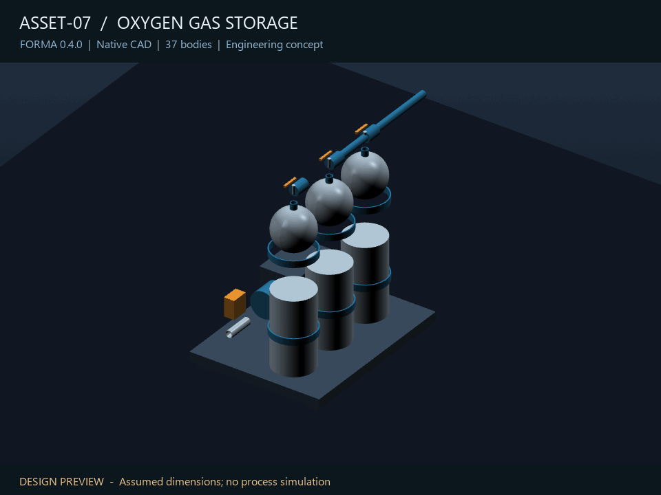

# ASSET-07 — Oxygen buffer, optional compressor and finite gas storage

[Design brief](brief.md) · [Shared parametric source](../tools/build_machines.py) · [STEP assembly](artifacts/assembly.step) · [GIF](renders/preview.gif)

## Engineering records

- [MechanicalIR](artifacts/mechanical.ir.json)
- [Forma MCP compilation](artifacts/forma-compiled.json)
- [Validation](artifacts/validation.json)
- [Original provenance](artifacts/provenance.json)

Dimensions and motion are concept assumptions. This is an offline CAD inspection preview, not an operating process simulation. Original MCP responses and provenance are retained verbatim; paths in those historical records describe the build-time layout. Use the relative links above for the current files.
