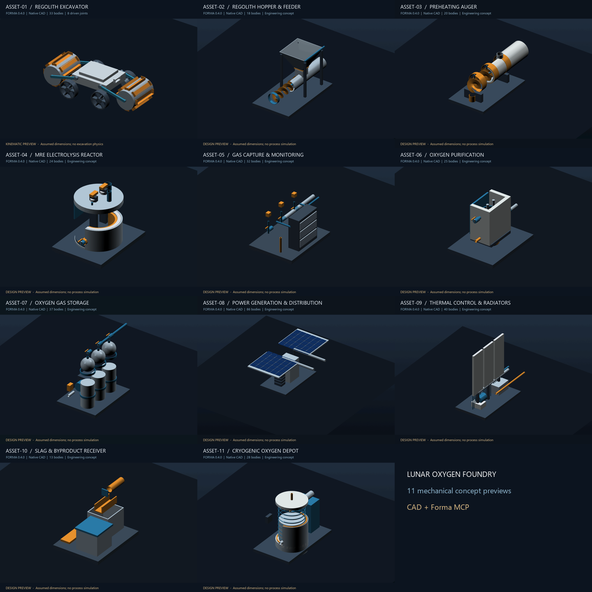

# Lunar oxygen foundry — asset library

Each numbered machine has the same layout:

```text
NN-machine-name/
├── README.md       # Preview and links
├── brief.md        # Requirements and research sources
├── artifacts/      # STEP, meshes, joints, Forma IR and MCP evidence
└── renders/        # preview.gif and preview.png
```

The excavator's dedicated parametric source lives in its `source/` directory.
The other ten machines share `tools/build_machines.py`. `tools/` also contains
rendering, MCP submission and gallery verification utilities. `rassor/` holds
the separately attributed NASA reference mesh. `gallery/` contains the overview.
Local failed builds and old packaging files are preserved in ignored `.local/`.

## Machines

| Asset | Preview |
|---|---|
| [01 — Regolith excavator](01-regolith-excavator/) | [GIF](01-regolith-excavator/renders/preview.gif) |
| [02 — Hopper and feeder](02-regolith-hopper-and-feeder/) | [GIF](02-regolith-hopper-and-feeder/renders/preview.gif) |
| [03 — Preheating auger](03-preheating-auger/) | [GIF](03-preheating-auger/renders/preview.gif) |
| [04 — MRE reactor](04-mre-electrolysis-reactor/) | [GIF](04-mre-electrolysis-reactor/renders/preview.gif) |
| [05 — Gas capture](05-gas-capture-and-instrumentation/) | [GIF](05-gas-capture-and-instrumentation/renders/preview.gif) |
| [06 — Oxygen purification](06-oxygen-purification/) | [GIF](06-oxygen-purification/renders/preview.gif) |
| [07 — Gas storage](07-oxygen-compression-and-storage/) | [GIF](07-oxygen-compression-and-storage/renders/preview.gif) |
| [08 — Power system](08-power-generation-and-distribution/) | [GIF](08-power-generation-and-distribution/renders/preview.gif) |
| [09 — Thermal control](09-thermal-control-and-heat-rejection/) | [GIF](09-thermal-control-and-heat-rejection/renders/preview.gif) |
| [10 — Slag receiver](10-slag-and-reduced-metals-receiver/) | [GIF](10-slag-and-reduced-metals-receiver/renders/preview.gif) |
| [11 — Cryogenic depot](11-oxygen-liquefaction-and-lox-depot/) | [GIF](11-oxygen-liquefaction-and-lox-depot/renders/preview.gif) |



## Rebuild and verify

Use Python with Forma 0.4.0, OpenCAD 0.2.4 (native OCCT/CadQuery), NumPy, VTK and
Pillow. From the repository root:

```powershell
python assets/tools/verify_gallery.py
python assets/tools/render_gif.py
```

`verify_gallery.py` checks the local layout and animations offline. Add
`--online` to verify saved projects against the local Forma MCP backend on port
8020. `build_machines.py --asset N` authors a machine and submits it through MCP;
existing recorded responses prevent accidental duplicate submissions. Rebuilds
need that local backend. The excavator's `source/build.py --forma-source PATH`
uses the v0.4.0 checkout's CAD adapter and writes to a fresh `--output` directory.

## Evidence and scope

Original generated JSON, revision snapshots, MCP responses and provenance remain
unchanged. Absolute local paths and old filenames inside them are historical
build evidence, not portable entrypoints. Current paths are indexed by each
machine README and `gallery/verification.json`.

These are mechanical concepts with assumed dimensions and inspection motion.
They do not establish working excavation, chemistry, electrical power, thermal
control or OpenIndustries integration. ASSET-11 remains a Phase 2 concept.
